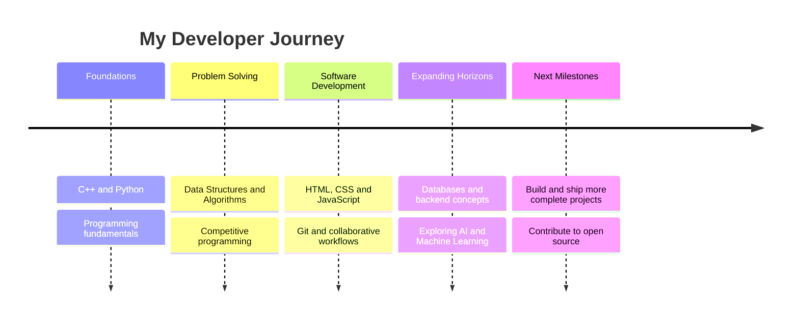
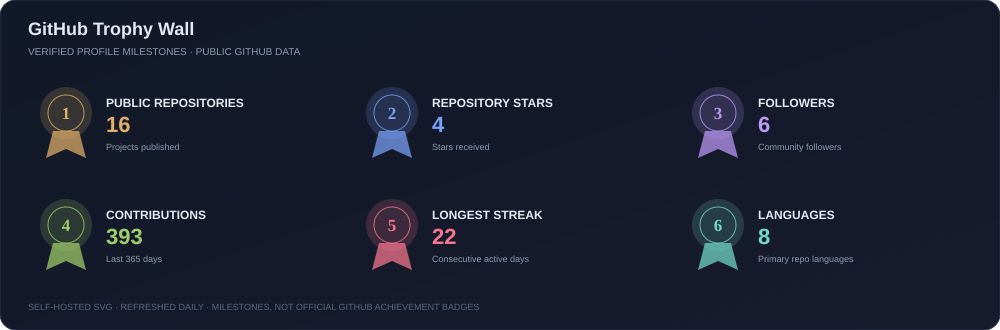
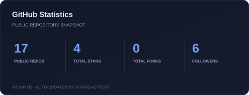
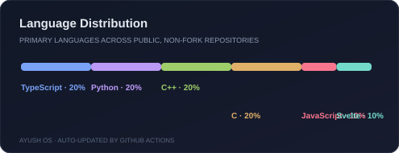
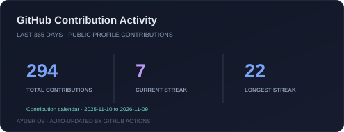
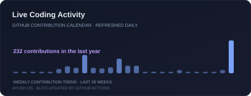
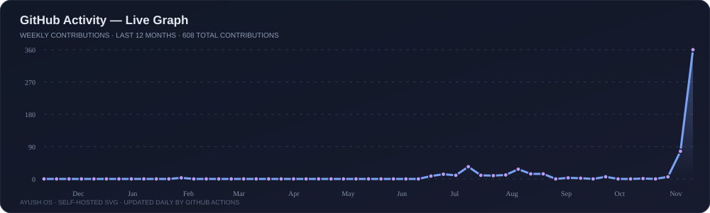

<p align="center">
  
</p>

<!-- HACKER OS -->
<h2 align="center">⌨️ AYUSH OS // DEVELOPER CONSOLE</h2>

<div align="center">

```bash
┌──(ayush㉿nits)-[~]
└─$ ./ayush-os --boot

[ OK ] Loading developer profile...
[ OK ] Mounting skills: C++ | DSA | Python | Web
[ OK ] Connecting to NIT Silchar // CSE '29
[ OK ] Initializing build mode...

┌──(ayush㉿nits)-[~/console]
└─$ help

  about       → Who am I?
  projects    → Explore things I'm building
  algorithms  → Competitive programming profiles
  connect     → Get in touch

┌──(ayush㉿nits)-[~/console]
└─$ status
  LEARNING // BUILDING // ITERATING
```

</div>

<p align="center">
  <a href="#-about-me">[ ABOUT ]</a> ·
  <a href="#-project-command-centre">[ PROJECTS ]</a> ·
  <a href="https://github.com/ayushverma9408/ayush-os">[ AYUSH OS PORTFOLIO ]</a> ·
  <a href="#-competitive-programming">[ ALGORITHMS ]</a> ·
  <a href="#-thanks-for-visiting">[ CONNECT ]</a>
</p>

<h1 align="center">Hi, I'm Ayush Verma 👋</h1>
<h3 align="center">CSE Undergraduate @ NIT Silchar'29</h3>
<p align="center">
  <em>Competitive Programming • Problem Solving • Exploring Software Development</em>
</p>

<p align="center">
  
</p>

---

## 👨‍💻 About Me

- 🎓 **B.Tech CSE student** at NIT Silchar (Class of 2029)
- 🏫 **Kendriya Vidyalaya alumnus** and former School Captain
- 💻 I enjoy competitive programming, algorithms, and challenging problem-solving
- 🌱 Currently exploring **DSA, AI/ML, and Web Development**
- 🎯 Working towards **Candidate Master on Codeforces** and **Guardian on LeetCode**
- 🤝 Interested in collaborating on useful software and learning-focused projects
- 📫 **Email:** [ayushverma19341@gmail.com](mailto:ayushverma19341@gmail.com)

---

## 🎯 Current Focus

- Building **AYUSH OS**, my standalone developer portfolio with SvelteKit, TypeScript, and a terminal-inspired interface
- Strengthening **Data Structures, Algorithms, and problem-solving**
- Improving contest performance on **Codeforces, CodeChef, and LeetCode**
- Learning **full-stack web development**
- Exploring **AI/ML** and practical applications
- Building a stronger foundation in software engineering

## 🧭 Developer Progression Timeline

A snapshot of the areas I'm building experience in—not a claim of mastery.



## ✨ Skill Constellation

The map below groups the technologies and concepts I'm learning and applying.

```text
                         AYUSH // SKILL MAP
                                  |
             +--------------------+--------------------+
             |                    |                    |
        PROGRAMMING          PROBLEM SOLVING       DEVELOPMENT
             |                    |                    |
          C++ / Python        DSA / Algorithms     HTML / CSS
          SQL (learning)      Competitive Prog.    JavaScript
                                                   SvelteKit
                                                   TypeScript
             |
        EXPLORATION
             |
          AI / ML
          Data Science
```

<p align="center">
  
</p>

---

## 🏅 Achievements

- 🎓 Scored **97% in CBSE Class XII**
- 🏫 Served as **School Captain** at Kendriya Vidyalaya
- 💻 Active problem-solving across **LeetCode, Codeforces, and CodeChef**

## 🌍 Open Source

- Interested in exploring open-source projects and collaborative development.
- Learning Git workflows, code reviews, and contributing maintainable code.
- Open to beginner-friendly issues and meaningful collaborations.

## 🔨 Currently Building

| Project / Area | Current status |
|---|---|
| **FloodWatch** | Project concept and prototype planning |
| **Web Development** | Learning and experimenting with web technologies |
| **Competitive Programming** | Consistent practice and contest improvement |

---

## 🛰️ Project Command Centre

> A live index of selected work. Project status is kept explicit—no demo or completion claims unless they're real.

<p align="center">
  <a href="https://github.com/ayushverma9408/ayush-os">
    
  </a>
</p>

<table>
  <tr>
    <td width="100%" valign="top">
      <h3>🖥️ AYUSH OS — Developer Portfolio</h3>
      <a href="https://github.com/ayushverma9408/ayush-os">
        
      </a>
      <p>A standalone, terminal-inspired portfolio designed as a personal developer command centre, with sections for my introduction, projects, skills, coding profiles, and contact links.</p>
      <p><strong>Stack:</strong> SvelteKit · Svelte 5 · TypeScript · Vite · Lucide</p>
      <p><sub>Status: Initial scaffold committed; deployment and live URL are not configured yet.</sub></p>
    </td>
  </tr>
</table>

<table>
  <tr>
    <td width="50%" valign="top">
      <h3>🏠 Hostel Allotment System</h3>
      <a href="https://github.com/ayushverma9408/Hacakathon-hostel-allotment-system">
        
      </a>
      <p>Automated hostel-room allocation with capacity checks, waitlist handling, spreadsheet import/export, and live preview.</p>
      <p><strong>Stack:</strong> SvelteKit · TypeScript · Tailwind CSS · SheetJS</p>
      <p><sub>Status: Repository available</sub></p>
    </td>
    <td width="50%" valign="top">
      <h3>📚 JEE Advanced Paper Archive</h3>
      <a href="https://github.com/ayushverma9408/JEE-ADVANCED-PAPER-ARCHIVE">
        
      </a>
      <p>A growing archive focused on organizing JEE Advanced paper resources.</p>
      <p><strong>Focus:</strong> Education · Exam resources</p>
      <p><sub>Status: Repository available</sub></p>
    </td>
  </tr>
  <tr>
    <td width="50%" valign="top">
      <h3>🌊 FloodWatch</h3>
      <p>Hackathon concept exploring a flood-monitoring solution combining hardware and software.</p>
      <p><strong>Focus:</strong> IoT · Sensors · Data visualization</p>
      <p><sub>Status: Concept / prototype planning</sub></p>
    </td>
    <td width="50%" valign="top">
      <h3>🧠 Competitive Programming</h3>
      <a href="https://github.com/ayushverma9408/Codeforces_9408">
        
      </a>
      <p>Problem-solving practice, algorithm implementations, and contest learnings.</p>
      <p><strong>Focus:</strong> C++ · DSA · Algorithms</p>
      <p><sub>Status: Ongoing practice</sub></p>
    </td>
  </tr>
</table>

---

<h2 align="center">🏆 Competitive Programming</h2>

<p align="center">
  <a href="https://leetcode.com/u/AYUSHVERMA9408/">
    
  </a>
  &nbsp;
  <a href="https://codeforces.com/profile/ayushverma9408">
    
  </a>
  &nbsp;
  <a href="https://www.codechef.com/users/ayushverma9408">
    
  </a>
</p>

<p align="center">
  
</p>
</p>
<p align="center">
  <a href="https://leetcode.com/u/AYUSHVERMA9408/">
    
  </a>
  <a href="https://codeforces.com/profile/ayushverma9408">
    
  </a>
</p>

<p align="center">
  <a href="https://www.codechef.com/users/ayushverma9408">
    
  </a>
</p>
<h2 align="center">🏅 LeetCode Badges and Heat-Map </h2>
<p align="center"> 
  
  
  
  
</p>
</p>
<p align="center">
  <a href="https://leetcode.com/u/AYUSHVERMA9408/">
    
  </a>
</p>
 
<div align="center">

| Platform | Profile |
|----------|---------|
| 🟠 LeetCode | **AYUSHVERMA9408** |
| 🔵 Codeforces | [**ayushverma9408**](https://codeforces.com/profile/ayushverma9408) |
| 🟤 CodeChef | [**ayushverma9408**](https://www.codechef.com/users/ayushverma9408) |

</div>

---

## 🏆 GitHub Trophy Wall

<p align="center">
  
</p>

## 📊 Coding Activity Dashboard

<p align="center">
  
  
</p>

<p align="center">
  
</p>

## ⏱️ Live Coding Dashboard

<p align="center">
  
  
</p>

<p align="center">
  <sub>These cards reflect public GitHub repository data, not a real-time keystroke or editor timer.</sub>
</p>

<details>
  <summary>⚡ Enable editor-time tracking (optional)</summary>

  To show actual coding hours and editor/language breakdowns, connect a [WakaTime](https://wakatime.com/) account and replace `YOUR_WAKATIME_USERNAME` below with your WakaTime username:

  ```html
  
  ```

  This panel is intentionally not enabled until an account username is configured.
</details>

---

## 📈 GitHub Activity — Live Graph

<p align="center">
  <a href="https://github.com/ayushverma9408">
    
  </a>
</p>

---

## 📡 YouTube Channel 
<p align="center" href="https://youtube.com/@AyushVerma_9408">
  
</p>
<h1 align="center">Ayush Verma ◉JEEPHYX◉</h1>
<div align="center">
<a href="https://youtube.com/@AyushVerma_9408">
    
</a>


  
</div>
<br clear="both">
<h2 align="center">🤝 Connect With Me</h2>

<p align="center">
  <a href="https://linkedin.com/in/ayushverma9408">
    
  </a>
  <a href="https://instagram.com/ayushverma9408">
    
  </a>
  <a href="https://www.youtube.com/c/ayushverma_9408">
    
  </a>
  <a href="https://www.codechef.com/users/ayushverma9408">
    
  </a>
  <a href="https://codeforces.com/profile/ayushverma9408">
    
  </a>
  <a href="https://leetcode.com/u/AYUSHVERMA9408/">
    
  </a>
</p>

---

<h2 align="center">🛠️ Languages and Tools</h2>

<h3 align="center">Programming Languages</h3>
<p align="center">
  
</p>

<h3 align="center">Web Development</h3>
<p align="center">
  
</p>

<h3 align="center">Data Science and Machine Learning</h3>
<p align="center">
  
  &nbsp;&nbsp;
  
  &nbsp;&nbsp;
  
</p>

<h3 align="center">Tools, Platforms and Hardware</h3>
<p align="center">
  
</p>

---

## 🛰️ GitHub Mission Control

<p align="center">
  <a href="https://github.com/ayushverma9408?tab=repositories">
    
  </a>
  <a href="https://github.com/ayushverma9408?tab=stars">
    
  </a>
  <a href="https://github.com/ayushverma9408/ayushverma9408/actions">
    
  </a>
  <a href="https://github.com/ayushverma9408/ayushverma9408/issues">
    
  </a>
</p>

<p align="center">
  <a href="https://github.com/ayushverma9408/ayushverma9408/actions/workflows/contribution-animations.yml">
    
  </a>
</p>

| Mission | Destination |
|---|---|
| Browse code | [All repositories](https://github.com/ayushverma9408?tab=repositories) |
| Follow development | [Commit activity](https://github.com/ayushverma9408?tab=overview) |
| Check automation | [GitHub Actions](https://github.com/ayushverma9408/ayushverma9408/actions) |
| Track improvements | [Issues and discussions](https://github.com/ayushverma9408/ayushverma9408/issues) |

<sub>Mission control links to live GitHub pages; workflow status is supplied by GitHub Actions.</sub>

---

<!-- ================= CONTRIBUTION SHOWCASE ================= -->

<h2 align="center">⚡ CONTRIBUTION MATRIX ⚡</h2>

<!-- 3D CONTRIBUTIONS -->
<h3 align="center">🌆 3D CONTRIBUTION CITY</h3>

<p align="center">
  
</p>

<!-- SNAKE ANIMATION -->
<h3 align="center">🐍 SNAKE VS CONTRIBUTIONS</h3>

<p align="center">
  <picture>
    <source media="(prefers-color-scheme: dark)"
      srcset="https://raw.githubusercontent.com/ayushverma9408/ayushverma9408/output/github-contribution-grid-snake-dark.svg">
    <source media="(prefers-color-scheme: light)"
      srcset="https://raw.githubusercontent.com/ayushverma9408/ayushverma9408/output/github-contribution-grid-snake.svg">
    
  </picture>
</p>

<!-- PACMAN ANIMATION -->
<h3 align="center">👾 PACMAN CONTRIBUTION GAME</h3>

<p align="center">
  <picture>
    <source media="(prefers-color-scheme: dark)"
      srcset="https://raw.githubusercontent.com/ayushverma9408/ayushverma9408/output/pacman-contribution-graph-dark.svg">
    <source media="(prefers-color-scheme: light)"
      srcset="https://raw.githubusercontent.com/ayushverma9408/ayushverma9408/output/pacman-contribution-graph.svg">
    
  </picture>
</p>

<!-- END CONTRIBUTION SHOWCASE -->

<!-- PROFILE FOOTER -->
---

<h2 align="center">⚡ Thanks for Visiting!</h2>

<p align="center">
  <em>"Consistency beats intensity. Keep learning, keep building."</em>
</p>

<p align="center">
  <a href="mailto:ayushverma19341@gmail.com">Let's connect</a>
  &nbsp; • &nbsp;
  <a href="https://github.com/ayushverma9408">Explore my repositories</a>
</p>

<p align="center">
  
</p>

<p align="center">
  <sub>Made with curiosity, code, and consistency.</sub>
</p>


