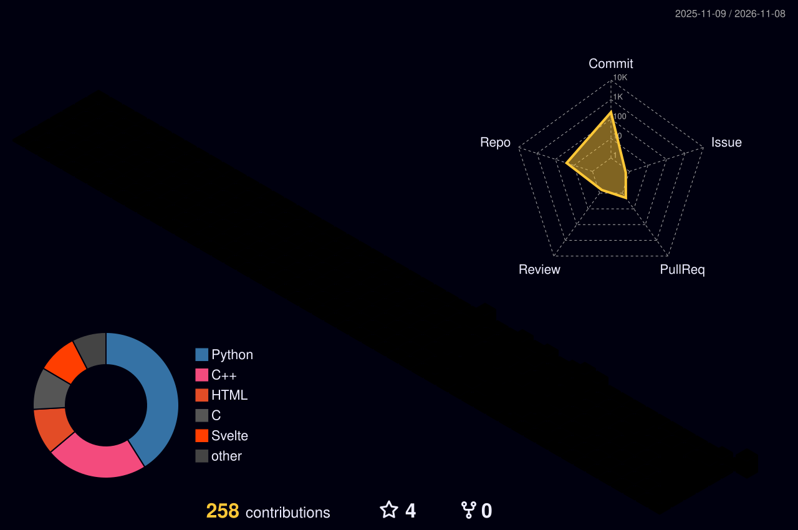

<p align="center">
  
</p>

<!-- HACKER TERMINAL INTRO -->
<div align="center">

```bash
┌──(ayush㉿nits)-[~]
└─$ whoami
Ayush Verma | CSE @ NIT Silchar

└─$ interests --show
Competitive Programming • Algorithms • Software Development

└─$ status
Learning, building, and improving — one commit at a time.
```

</div>

<h1 align="center">Hi, I'm Ayush Verma 👋</h1>
<h3 align="center">CSE Undergraduate @ NIT Silchar'29</h3>
<p align="center">
  <em>Competitive Programming • Problem Solving • Exploring Software Development</em>
</p>

<p align="center">
  
</p>

---

## 👨‍💻 About Me

- 🎓 **B.Tech CSE student** at NIT Silchar (Class of 2029)
- 🏫 **Kendriya Vidyalaya alumnus** and former School Captain
- 💻 I enjoy competitive programming, algorithms, and challenging problem-solving
- 🌱 Currently exploring **DSA, AI/ML, and Web Development**
- 🎯 Working towards **Candidate Master on Codeforces** and **Guardian on LeetCode**
- 🤝 Interested in collaborating on useful software and learning-focused projects
- 📫 **Email:** [ayushverma19341@gmail.com](mailto:ayushverma19341@gmail.com)

---

## 🎯 Current Focus

- Strengthening **Data Structures, Algorithms, and problem-solving**
- Improving contest performance on **Codeforces, CodeChef, and LeetCode**
- Learning **full-stack web development**
- Exploring **AI/ML** and practical applications
- Building a stronger foundation in software engineering

## 🏅 Achievements

- 🎓 Scored **97% in CBSE Class XII**
- 🏫 Served as **School Captain** at Kendriya Vidyalaya
- 💻 Active problem-solving across **LeetCode, Codeforces, and CodeChef**

## 🌍 Open Source

- Interested in exploring open-source projects and collaborative development.
- Learning Git workflows, code reviews, and contributing maintainable code.
- Open to beginner-friendly issues and meaningful collaborations.

## 🔨 Currently Building

| Project / Area | Current status |
|---|---|
| **FloodWatch** | Project concept and prototype planning |
| **Web Development** | Learning and experimenting with web technologies |
| **Competitive Programming** | Consistent practice and contest improvement |

---

<h2 align="center">🏆 Competitive Programming</h2>

<p align="center">
  <a href="https://leetcode.com/u/AYUSHVERMA9408/">
    
  </a>
  &nbsp;
  <a href="https://codeforces.com/profile/ayushverma9408">
    
  </a>
  &nbsp;
  <a href="https://www.codechef.com/users/ayushverma9408">
    
  </a>
</p>

<p align="center">
  
</p>
</p>
<p align="center">
  <a href="https://leetcode.com/u/AYUSHVERMA9408/">
    
  </a>
  <a href="https://codeforces.com/profile/ayushverma9408">
    
  </a>
</p>

<p align="center">
  <a href="https://www.codechef.com/users/ayushverma9408">
    
  </a>
</p>
<h2 align="center">🏅 LeetCode Badges and Heat-Map </h2>
<p align="center"> 
  
  
  
  
</p>
</p>
<p align="center">
  <a href="https://leetcode.com/u/AYUSHVERMA9408/">
    
  </a>
</p>
 
<div align="center">

| Platform | Profile |
|----------|---------|
| 🟠 LeetCode | **AYUSHVERMA9408** |
| 🔵 Codeforces | [**ayushverma9408**](https://codeforces.com/profile/ayushverma9408) |
| 🟤 CodeChef | [**ayushverma9408**](https://www.codechef.com/users/ayushverma9408) |

</div>

---

## 🏆 GitHub Trophy Wall

<p align="center">
  
</p>

## 📊 Coding Activity Dashboard

<p align="center">
  
  
</p>

<p align="center">
  
</p>

## 📈 GitHub Activity — Live Graph

<p align="center">
  <a href="https://github.com/ayushverma9408">
    
  </a>
</p>

---

## 📡 YouTube Channel 
<p align="center" href="https://youtube.com/@AyushVerma_9408">
  
</p>
<h1 align="center">Ayush Verma ◉JEEPHYX◉</h1>
<div align="center">
<a href="https://youtube.com/@AyushVerma_9408">
    
</a>


  
</div>
<br clear="both">
<h3 align="left">Connect with me:</h3>
<p align="left">
<a href="https://linkedin.com/in/ayushverma9408" target="blank"></a>
<a href="https://instagram.com/ayushverma9408" target="blank"></a>
<a href="https://www.youtube.com/c/ayushverma_9408" target="blank"></a>
<a href="https://www.codechef.com/users/ayushverma9408" target="blank"></a>
<a href="https://codeforces.com/profile/ayushverma9408" target="blank"></a>
<a href="https://www.leetcode.com/ayushverma9408" target="blank"></a>
</p>
<h3 align="left">Languages and Tools:</h3>
<p align="left"> <a href="https://developer.android.com" target="_blank" rel="noreferrer">  </a> <a href="https://www.arduino.cc/" target="_blank" rel="noreferrer">  </a> <a href="https://aws.amazon.com" target="_blank" rel="noreferrer">  </a> <a href="https://www.cprogramming.com/" target="_blank" rel="noreferrer">  </a> <a href="https://www.w3schools.com/cpp/" target="_blank" rel="noreferrer">  </a> <a href="https://www.w3schools.com/css/" target="_blank" rel="noreferrer">  </a> <a href="https://git-scm.com/" target="_blank" rel="noreferrer">  </a> <a href="https://www.w3.org/html/" target="_blank" rel="noreferrer">  </a> <a href="https://www.mysql.com/" target="_blank" rel="noreferrer">  </a> <a href="https://nodejs.org" target="_blank" rel="noreferrer">  </a> <a href="https://pandas.pydata.org/" target="_blank" rel="noreferrer">  </a> <a href="https://www.python.org" target="_blank" rel="noreferrer">  </a> <a href="https://scikit-learn.org/" target="_blank" rel="noreferrer">  </a> <a href="https://www.tensorflow.org" target="_blank" rel="noreferrer">  </a> </p>

---

<!-- ================= CONTRIBUTION SHOWCASE ================= -->

<h2 align="center">⚡ CONTRIBUTION MATRIX ⚡</h2>

<!-- 3D CONTRIBUTIONS -->
<h3 align="center">🌌 3D CONTRIBUTION LANDSCAPE</h3>

<p align="center">
  
</p>

<!-- SNAKE ANIMATION -->
<h3 align="center">🐍 SNAKE VS CONTRIBUTIONS</h3>

<p align="center">
  <picture>
    <source media="(prefers-color-scheme: dark)"
      srcset="https://raw.githubusercontent.com/ayushverma9408/ayushverma9408/output/github-contribution-grid-snake-dark.svg">
    <source media="(prefers-color-scheme: light)"
      srcset="https://raw.githubusercontent.com/ayushverma9408/ayushverma9408/output/github-contribution-grid-snake.svg">
    
  </picture>
</p>

<!-- PACMAN ANIMATION -->
<h3 align="center">👾 PACMAN CONTRIBUTION GAME</h3>

<p align="center">
  <picture>
    <source media="(prefers-color-scheme: dark)"
      srcset="https://raw.githubusercontent.com/ayushverma9408/ayushverma9408/output/pacman-contribution-graph-dark.svg">
    <source media="(prefers-color-scheme: light)"
      srcset="https://raw.githubusercontent.com/ayushverma9408/ayushverma9408/output/pacman-contribution-graph.svg">
    
  </picture>
</p>

<!-- END CONTRIBUTION SHOWCASE -->

<!-- PROFILE FOOTER -->
---

<h2 align="center">⚡ Thanks for Visiting!</h2>

<p align="center">
  <em>"Consistency beats intensity. Keep learning, keep building."</em>
</p>

<p align="center">
  <a href="mailto:ayushverma19341@gmail.com">Let's connect</a>
  &nbsp; • &nbsp;
  <a href="https://github.com/ayushverma9408">Explore my repositories</a>
</p>

<p align="center">
  
</p>

<p align="center">
  <sub>Made with curiosity, code, and consistency.</sub>
</p>


